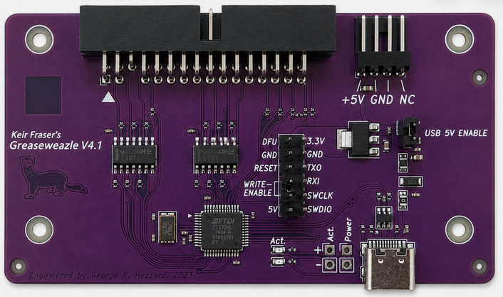
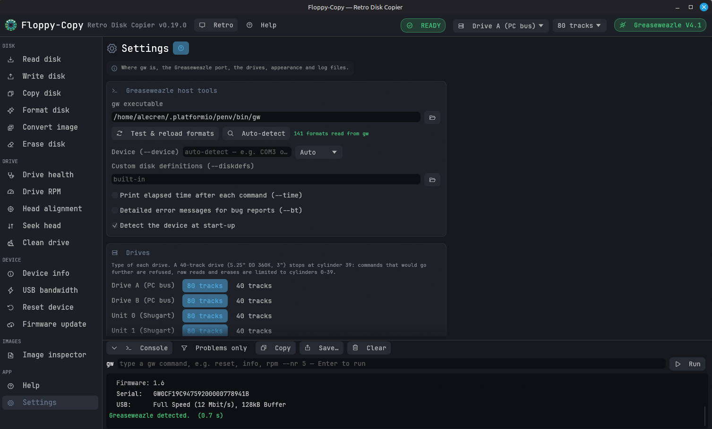
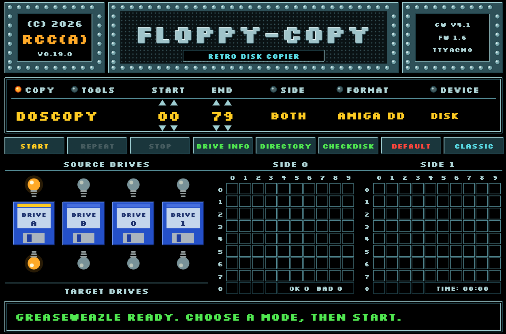

# Greaseweazle : Préservation et Archivage de Disquettes Rétro

Le projet **Greaseweazle** est une solution matérielle et logicielle open-source conçue par Keir Fraser. Elle permet de connecter d'anciens lecteurs de disquettes (formats 3", 3.5", 5.25" ou 8") directement à un ordinateur moderne via un port USB. 

Contrairement aux lecteurs de disquettes USB classiques du commerce qui sont limités aux formats PC standards (FAT), le Greaseweazle s'en affranchit en capturant et en écrivant les données au niveau du **flux magnétique brut** (*raw flux*). Cette approche permet de lire, analyser et restaurer la quasi-totalité des formats de disquettes historiques (Amiga, Atari ST, Commodore 64, Amstrad CPC, PC, ou encore des machines industrielles et des synthétiseurs musicaux), y compris les médias protégés contre la copie. C'est un outil indispensable pour la préservation du patrimoine numérique.



---

## Liens Utiles et Ressources du Projet

### 💻 Code Source et Logiciels
* **[Dépôt GitHub Principal](https://github.com/keirf/greaseweazle)** : Le code source officiel du projet et les outils hôtes.
* **[Téléchargement des Outils (Releases)](https://github.com/keirf/greaseweazle/releases)** : Les versions compilées des outils en ligne de commande pour contrôler l'appareil.
* **[Micrologiciel (Firmware)](https://github.com/keirf/greaseweazle-firmware)** : Le dépôt officiel contenant le firmware destiné au processeur embarqué du module Greaseweazle.

### 📖 Documentation et Matériel
* **[Wiki Officiel Greaseweazle](https://github.com/keirf/greaseweazle/wiki)** : La documentation complète pour l'installation logicielle, la configuration et l'utilisation des commandes.
* **[Fichiers de Conception Matérielle (Design Files)](https://github.com/keirf/greaseweazle/wiki/Design-Files)** : Les schémas électroniques, listes de composants (BOM) et fichiers Gerber pour fabriquer ou comprendre les différentes versions de cartes (V4, V4.1, F7, etc.).

### 🛒 Acheter un Module
* **[Boutique Sordan (Vendeur)](https://sordan.ie/product/1530/greaseweazle-v41-usb-floppy-adapter-flux-reader-writer--case)** : Lien direct pour acquérir un adaptateur Greaseweazle V4.1 officiel prêt à l'emploi, livré avec son boîtier de protection imprimé en 3D.

# Guide d'Installation et de Test du Greaseweazle V4.1 sous Linux

Ce document résume les étapes de vérification matérielle, d'installation des outils hôtes et de test pour le module Greaseweazle sous Linux.

---

## 1. Vérification de la détection du matériel

Connectez le module Greaseweazle en USB et vérifiez sa détection :

```bash
alecren@alecren-soyo:~\$ lsusb
Bus 001 Device 003: ID 1209:4d69 Generic Greaseweazle
```

---

## 2. Installation des Outils Hôtes

Décompressez l'archive (ex. `greaseweazle-1.23.zip`) puis lancez l'installation via Python :

```bash
cd ~/Téléchargements/greaseweazle-1.23
python3 -m pip install .
Processing ./.
  Installing build dependencies ... done
  Getting requirements to build wheel ... done
  Preparing metadata (pyproject.toml) ... done
Collecting crcmod (from greaseweazle==1.23)
  Downloading crcmod-1.7.tar.gz (89 kB)
  Installing build dependencies ... done
  Getting requirements to build wheel ... done
  Preparing metadata (pyproject.toml) ... done
Collecting bitarray>=3 (from greaseweazle==1.23)
  Downloading bitarray-3.12.3-cp312-cp312-manylinux2014_x86_64.manylinux_2_17_x86_64.manylinux_2_28_x86_64.whl.metadata (40 kB)
...
Requirement already satisfied: pyserial in /home/alecren/.platformio/penv/lib/python3.12/site-packages (from greaseweazle==1.23) (3.5)
Requirement already satisfied: certifi>=2023.5.7 in /home/alecren/.platformio/penv/lib/python3.12/site-packages (from requests->greaseweazle==1.23) (2026.7.22)
Downloading bitarray-3.12.3-cp312-cp312-manylinux2014_x86_64.manylinux_2_17_x86_64.manylinux_2_28_x86_64.whl (404 kB)
Building wheels for collected packages: greaseweazle, crcmod
  Building wheel for greaseweazle (pyproject.toml) ... done
  Created wheel for greaseweazle: filename=greaseweazle-1.23-cp312-cp312-linux_x86_64.whl size=196972 sha256=e16cc9a0996db0cd20fb8462b39301ee9607941e726213a328ff42098c22da59
  Stored in directory: /tmp/pip-ephem-wheel-cache-8zw21spm/wheels/ec/9c/e5/a88c859d6f83bdb97ae340a44cf9c8b7e8963c849f9fa89244
  Building wheel for crcmod (pyproject.toml) ... done
  Created wheel for crcmod: filename=crcmod-1.7-cp312-cp312-linux_x86_64.whl size=31828 sha256=85d6b2d9d3076b8cb02758a263896117ce9d3d0ab9f5680d089528846b3c2c3d
  Stored in directory: /home/alecren/.cache/pip/wheels/76/08/0b/caa8b1380122cbfe6a03eaccbec0f63c67e619af4e30ca5e2a
Successfully built greaseweazle crcmod
Installing collected packages: crcmod, bitarray, greaseweazle
Successfully installed bitarray-3.12.3 crcmod-1.7 greaseweazle-1.23
```

---

## 3. Commandes Principales et Diagnostic

### A. Affichage de l'aide et des informations du module
* **Liste des commandes (`gw`) :** Permet d'afficher les actions disponibles (`info`, `read`, `write`, `erase`, `rpm`, etc.).
```bash
Usage: /home/alecren/.platformio/penv/bin/gw [--time] [action] [-h] ...
  --time      Print elapsed time after action is executed
  -h, --help  Show help message for specified action
Actions:
  info        Display information about the Greaseweazle setup.
  read        Read a disk to the specified image file.
  write       Write a disk from the specified image file.
  convert     Convert between image formats.
  erase       Erase a disk.
  clean       Clean a drive in a zig-zag pattern using a cleaning disk.
  seek        Seek to the specified cylinder.
  delays      Display (and optionally modify) drive-delay parameters.
  update      Update the Greaseweazle device firmware to latest (or specified) version.
  pin         Change the setting of a user-modifiable interface pin.
  reset       Reset the Greaseweazle device to power-on default state.
  bandwidth   Report the available USB bandwidth for the Greaseweazle device.
  rpm         Measure RPM of drive spindle.
```
* **Informations de la carte (`gw info`) :**
```bash
alecren@alecren-soyo:~/Téléchargements/greaseweazle-1.23\$ gw info
Host Tools: 1.23
Device:
  Port:     /dev/ttyACM0
  Model:    Greaseweazle V4.1
  MCU:      AT32F403A, 216MHz, 224kB SRAM
  Firmware: 1.6
  Serial:   GW0CF19C94759200000778941B
  USB:      Full Speed (12 Mbit/s), 128kB Buffer
```
* **Mise à jour du firmware (`gw update`) :** Vérifie ou met à jour le micrologiciel de l'appareil.
```bash
Downloading latest firmware: greaseweazle-firmware-1.6.upd
Updating Main Firmware to version 1.6...
** SKIPPING UPDATE:
Device is already running version 1.6.
Use --force to update anyway.
```
---

## 4. Connexion et Tests du Lecteur de Disquettes

> 💡 **Câblage :** Utilisez une nappe de lecteur disquette standard avec une section croisée pour configurer par défaut le lecteur en tant que Disque A.

### A. Test de la vitesse de rotation (`gw rpm`)
Mesure la vitesse du moteur du lecteur :
```bash
alecren@alecren-soyo:~/Téléchargements/greaseweazle-1.23\$ gw rpm
Rate: 300.538 rpm ; Period: 199.642 ms
```
*(Option `--drive B` utilisable si vous employez un câble droit au lieu d'un câble croisé).*

```bash
alecren@alecren-soyo:~/Téléchargements/greaseweazle-1.23$ gw rpm --help
usage: gw rpm [options]

Measure RPM of drive spindle.

options:
  -h, --help       show this help message and exit
  --device DEVICE  greaseweazle device name
  --drive DRIVE    drive to read (default: A)
  --nr N           number of iterations (default: 1)

DRIVE: Drive (and bus) identifier:
  0 | 1 | 2 | 3       :: Shugart bus unit
  A | B               :: IBM/PC bus unit
```


### B. Effacement et lecture de disquettes
* **Effacement complet (`gw erase`) :** Efface les pistes de la disquette.
```bash
alecren@alecren-soyo:~/Téléchargements/greaseweazle-1.23$ gw erase
Erasing c=0-81:h=0-1, revs=1
T0.0: Erasing Track
T0.1: Erasing Track
T1.0: Erasing Track
T1.1: Erasing Track
T2.0: Erasing Track
T2.1: Erasing Track
...
T80.0: Erasing Track
T80.1: Erasing Track
T81.0: Erasing Track
T81.1: Erasing Track
```

* **Lecture de disquette (`gw read`) :** Exemple de lecture d'une disquette AmigaDOS vers un fichier image :
```bash
alecren@alecren-soyo:~/Téléchargements/greaseweazle-1.23$ gw read --format=amiga.amigados mon_jeu.adf
Reading c=0-79:h=0-1 revs=1.1
Format amiga.amigados
T0.0: AmigaDOS (11/11 sectors) from Raw Flux (49372 flux in 219.61ms)
T0.1: AmigaDOS (11/11 sectors) from Raw Flux (46281 flux in 219.61ms)
T1.0: AmigaDOS (11/11 sectors) from Raw Flux (45593 flux in 219.61ms)
T1.1: AmigaDOS (11/11 sectors) from Raw Flux (44600 flux in 219.61ms)
T2.0: AmigaDOS (11/11 sectors) from Raw Flux (46300 flux in 219.61ms)
T2.1: AmigaDOS (11/11 sectors) from Raw Flux (47835 flux in 219.61ms)
..............
T75.0: AmigaDOS (11/11 sectors) from Raw Flux (47753 flux in 219.61ms)
T75.1: AmigaDOS (10/11 sectors) from Raw Flux (46699 flux in 219.61ms)
T75.1: AmigaDOS (11/11 sectors) from Raw Flux (154729 flux in 724.58ms) (Retry #1.1)
T76.0: AmigaDOS (11/11 sectors) from Raw Flux (46327 flux in 219.61ms)
T76.1: AmigaDOS (11/11 sectors) from Raw Flux (45908 flux in 219.61ms)
T77.0: AmigaDOS (11/11 sectors) from Raw Flux (48499 flux in 219.61ms)
T77.1: AmigaDOS (11/11 sectors) from Raw Flux (45972 flux in 219.61ms)
T78.0: AmigaDOS (11/11 sectors) from Raw Flux (45963 flux in 219.61ms)
T78.1: AmigaDOS (11/11 sectors) from Raw Flux (46347 flux in 219.61ms)
T79.0: AmigaDOS (11/11 sectors) from Raw Flux (45466 flux in 219.61ms)
T79.1: AmigaDOS (11/11 sectors) from Raw Flux (53862 flux in 219.61ms)
Cyl-> 0         1         2         3         4         5         6         7         
H. S: 01234567890123456789012345678901234567890123456789012345678901234567890123456789
0. 0: ................................................................................
0. 1: ................................................................................
0. 2: ................................................................................
0. 3: ................................................................................
0. 4: ................................................................................
0. 5: ................................................................................
0. 6: ................................................................................
0. 7: ................................................................................
0. 8: ................................................................................
0. 9: ................................................................................
0.10: ................................................................................
1. 0: ................................................................................
1. 1: ................................................................................
1. 2: ................................................................................
1. 3: ................................................................................
1. 4: ................................................................................
1. 5: ................................................................................
1. 6: ................................................................................
1. 7: ................................................................................
1. 8: ................................................................................
1. 9: ................................................................................
1.10: ................................................................................
Found 1760 sectors of 1760 (100%)
```

* **Ecriture de disquette (`gw write`) :** Exemple d'écriture d'une disquette AmigaDOS vers un fichier image :

```bash
alecren@alecren-soyo:~/Téléchargements/greaseweazle-1.23$ gw write --format=amiga.amigados mon_jeu.adf
Format amiga.amigados
Writing c=0-79:h=0-1
T0.0: Writing Track (Flux: 200.0ms period, 219.9 ms total, Terminate at index)
T0.1: Writing Track (Flux: 200.0ms period, 219.9 ms total, Terminate at index)
T1.0: Writing Track (Flux: 200.0ms period, 219.9 ms total, Terminate at index)
T1.1: Writing Track (Flux: 200.0ms period, 219.9 ms total, Terminate at index)
T2.0: Writing Track (Flux: 200.0ms period, 219.9 ms total, Terminate at index)
T2.1: Writing Track (Flux: 200.0ms period, 219.9 ms total, Terminate at index)
T3.0: Writing Track (Flux: 200.0ms period, 219.9 ms total, Terminate at index)
.....
T77.1: Writing Track (Flux: 200.0ms period, 219.9 ms total, Terminate at index)
T78.0: Writing Track (Flux: 200.0ms period, 219.9 ms total, Terminate at index)
T78.1: Writing Track (Flux: 200.0ms period, 219.9 ms total, Terminate at index)
T79.0: Writing Track (Flux: 200.0ms period, 219.9 ms total, Terminate at index)
T79.1: Writing Track (Flux: 200.0ms period, 219.9 ms total, Terminate at index)
All tracks verified
```

```bash

```

# Guide d'Installation et Configuration de Floppy-Copy (GUI Greaseweazle)

**Floppy-Copy** (anciennement *HappyGreaseFloppy*) est une interface graphique (GUI) moderne et conviviale pour le projet Greaseweazle. Elle permet de lire, écrire, copier et formater des disquettes rétro de manière visuelle.

*   Dépôt officiel du projet : [sohappy/Floppy-Copy](https://github.com/sohappy/Floppy-Copy)

---

## 1. Téléchargement et Versions

L'auteur d'origine ne fournissant pas de fichiers exécutables prêts à l'emploi (releases), des versions précompilées pour **Windows** et **Linux** sont mises à disposition sur ce fork :

*   Dépôt des Releases : [f4goh/Floppy-Copy](https://github.com/f4goh/Floppy-Copy)
*   Lien direct pour la version Linux (v1.9) : [HappyGreaseFloppy-linux-x86_64.zip](https://github.com/f4goh/Floppy-Copy/releases/download/1.9/HappyGreaseFloppy-linux-x86_64.zip)

---

## 2. Procédure d'Installation sous Linux

1. Téléchargez le fichier ZIP correspondant à votre système.
2. Décompressez l'archive téléchargée.
3. Ouvrez un terminal dans le dossier extrait et lancez le script d'installation :

```bash
alecren@alecren-soyo:~/Téléchargements/Floppy-Copy-main-linux-x86_64\$ ./install.sh 
Installed. Start Floppy-Copy from your applications menu (icon included).
```

Une fois le script exécuté, une icône **Floppy-Copy** apparaît automatiquement dans votre menu d'applications / menu démarrer de Linux.

---

## 3. Configuration Initiale

Lors du premier lancement, vous devez lier l'interface graphique à l'outil en ligne de commande `gw` (Greaseweazle Hôte) installé précédemment.

1. Allez dans le menu **Settings** (Paramètres) de Floppy-Copy.
2. Renseignez le chemin menant à l'exécutable `gw`.

> 💡 **Astuce :** Si vous ne connaissez pas l'emplacement de l'exécutable sur votre machine, tapez la commande `which gw` dans votre terminal.
> 
> *Exemple de chemin trouvé :*
> `/home/alecren/.platformio/penv/bin/gw`



---

## 4. Astuce d'Utilisation : Le mode "Retro" (X-COPY Style)

Floppy-Copy intègre un mode visuel nostalgique inspiré du célèbre logiciel de copie de disquettes **X-COPY** sur Amiga (plaques métalliques, police pixel, grilles de pistes).

*   **Activer le mode Retro :** Cliquez sur le bouton **"Retro"** dans la barre supérieure pour basculer sur l'interface plein écran à l'ancienne.
*   **Retourner au mode standard :** Cliquez sur le bouton **"Classic"** pour basculer à nouveau vers l'interface moderne.




